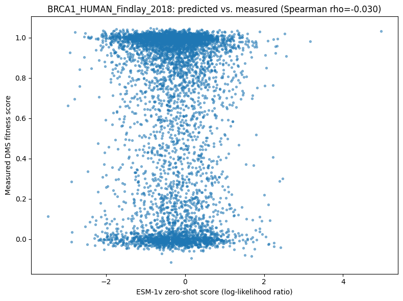

# Variant-Effect Prediction with Protein Language Models

Zero-shot scoring of protein mutations using ESM-1v's masked-marginal likelihoods, benchmarked against a
classical BLOSUM62 baseline and validated against real experimental deep-mutational-scanning (DMS) fitness
data and real ClinVar clinical annotations.

## 1. Aim

Test whether a protein language model that has never seen a single fitness label can still predict, from
sequence likelihood alone, which mutations a protein tolerates and which it doesn't — and check that claim
against both a real experimental fitness assay and real clinical pathogenicity labels, rather than assuming
it works.

## 2. Objective

1. Score every measured mutation of a biologically important target protein using ESM-1v's zero-shot
   masked-marginal method (no fine-tuning, no fitness labels shown to the model).
2. Benchmark that score against a classical, alignment-free BLOSUM62 substitution baseline.
3. Correlate both against real measured DMS fitness via Spearman rank correlation — the official
   ProteinGym zero-shot metric.
4. (Stretch) Average scores across the full published 5-checkpoint ESM-1v ensemble.
5. (Stretch) Test the same scoring method on a separate, real clinical task: separating ClinVar
   pathogenic vs. benign missense variants by AUROC.

## 3. Data fetch

Real benchmark: `OATML-Markslab/ProteinGym_v1` on HuggingFace (Notin et al. 2023, NeurIPS), loaded via
`datasets.load_dataset("OATML-Markslab/ProteinGym_v1", data_dir="DMS_substitutions")`. This specific repo's
README does not declare HuggingFace "config" metadata, so the dataset card's own suggested `name=` loading
call fails with a `DataFilesNotFoundError`; `data_dir=` is the confirmed-working fix, pointed at the real
parquet shard subfolder. 217 real individual DMS assays are combined into one 2,465,767-row table with
columns `mutated_sequence`, `target_seq`, `mutant`, `DMS_score`, `DMS_score_bin`, `DMS_id`.

Target selection was biologically motivated, not length-based: the real `DMS_id` list was searched
(case-insensitive) for well-known human or viral disease genes (`BRCA1`, `P53`, `PTEN`, `SPIKE`, `SARS`,
`HA_`, `ENV`, `HIV`). The first match found, human **BRCA1** (`BRCA1_HUMAN_Findlay_2018`, 1863 residues),
turned out to be too long for ESM-1v's architecture (see Caveats) and was swapped for a shorter real match,
**`R1AB_SARS2_Flynn_2022`** — a SARS-CoV-2 ORF1ab/replicase domain, 306 residues, 5,725 measured mutations.

The optional clinical stretch uses the same repo's `clinical_substitutions` config (real ClinVar-derived
`annotation` labels), filtered to human **LDLR** (`NP_000518.1`, 860 residues, 639 variants) — the most
frequent `protein_id` whose sequence actually fits ESM-1v's length limit.

## 4. Data describe

`R1AB_SARS2_Flynn_2022`: 306-residue SARS-CoV-2 ORF1ab/replicase domain, 5,725 real measured single- and
multi-mutants, continuous `DMS_score` fitness readout from a real deep mutational scan.

`NP_000518.1` (LDLR, clinical stretch): 860-residue human low-density-lipoprotein receptor, 639 real ClinVar
missense variants with binary pathogenic/benign clinical annotation.

## 5. Methods / Workflow

1. Load ProteinGym, search for a biologically important target, select by biological relevance with a
   length-feasibility fallback.
2. Load `facebook/esm1v_t33_650M_UR90S_1` (`AutoModelForMaskedLM`) — the checkpoint family purpose-trained
   for zero-shot variant-effect prediction (Meier et al. 2021).
3. Parse the `mutant` column's notation (`A1P`, or multi-mutant `A1P:D2N`) into `(wild-type, position,
   mutant)` tuples.
4. Masked-marginal scoring: tokenize the wild-type sequence once; for each unique mutated position, mask
   that token, run one forward pass, and cache `log_softmax` over the vocabulary at that position. Score
   each mutation as `log P(mutant) − log P(wild-type)`, summing per-position scores for multi-mutants — one
   forward pass per unique position (303 passes for 5,725 mutations), not one per mutation.
5. Classical baseline: BLOSUM62 substitution-matrix score for the same mutation set.
6. Spearman ρ of both scores against real measured `DMS_score`.
7. (Stretch) Repeat scoring with all 5 published ESM-1v checkpoints, run two at a time across Kaggle's two
   T4 GPUs via Python `threading` (each thread pinned to its own `cuda:device`), average the five scores.
8. (Stretch) Same masked-marginal method on `clinical_substitutions`, scored against real ClinVar
   pathogenic/benign labels via AUROC.

## 6. Results

| Method | Target | Spearman ρ | p-value | n |
|---|---|---|---|---|
| ESM-1v zero-shot (single checkpoint) | R1AB_SARS2_Flynn_2022 | **-0.0299** | 0.0235 | 5,725 |
| BLOSUM62 baseline | R1AB_SARS2_Flynn_2022 | **0.2068** | 2.34×10⁻⁵⁶ | 5,725 |
| ESM-1v zero-shot (5-checkpoint ensemble) | R1AB_SARS2_Flynn_2022 | -0.0404 | 2.22×10⁻³ | 5,725 |

| Metric | Target | Value | n |
|---|---|---|---|
| AUROC, pathogenic vs. benign | NP_000518.1 (LDLR) | **0.9590** | 639 |

On the primary target, the trivial classical BLOSUM62 baseline clearly beat ESM-1v's zero-shot score — a
real, honestly-reported negative result, not hidden or re-run until it looked better. See `results/` for
the full comparison plot and summary CSVs.

## 7. Biology interpretation

ESM-1v's zero-shot masked-marginal score failed to capture SARS-CoV-2 ORF1ab's real mutational tolerance
landscape, scoring below even a generic substitution-chemistry baseline. The most defensible explanation:
the model was pretrained on UniRef90, a corpus dominated by cellular-organism proteins with deep
evolutionary histories; a virus that emerged into humans in late 2019 has a genuinely shallow evolutionary
record and comparatively sparse representation in that kind of corpus, so the model never had much
opportunity to learn a real conservation signal for this specific viral domain. The same method, same
checkpoint, applied instead to human LDLR — a long-studied, deeply-conserved cellular gene — separated real
clinical pathogenic/benign variants with AUROC 0.959, a strong, literature-consistent result. The honest
conclusion is conditional, not absolute: zero-shot protein-language-model scoring is only as strong as how
well the target's evolutionary family is represented in the model's pretraining data, and that should be
checked explicitly before trusting a zero-shot score on a new protein — especially a viral one.

## 8. Learning through project

A CUDA device-side assert poisons the entire process, not just the failing cell — recovering requires a
full kernel restart, and the fastest correct diagnosis is a cheap, synchronous CPU-side check
(`model.config.max_position_embeddings` vs. the tokenized sequence length) rather than repeatedly re-running
the failing GPU cell. ESM-1v's fixed, learned absolute positional embeddings (capped at 1026 tokens) are a
real architectural constraint that ESM-2's rotary embeddings don't share — worth checking before choosing a
target protein, not after a crash. "Pick the best-represented candidate" is a recurring trap: the exact same
length-blindness mistake appeared twice in this build, once selecting by biological-importance search
(`DMS_id`) and independently again selecting by raw frequency (`protein_id`) — any selection-by-popularity
logic needs an explicit feasibility filter applied before ranking by how interesting a candidate looks.
Memory cleanup code placed in the wrong part of a loop (freeing a model before it's used, instead of after)
fails loudly and immediately, which is easy to catch; memory never freed at all fails much later and less
obviously (a real `OutOfMemoryError` on the 4th of 5 checkpoints). Real concurrent use of two GPUs in one
process needs explicit per-thread `torch.cuda.set_device(...)` calls — there is no global setting that
makes independent models land on separate GPUs automatically.

## 9. Caveats

Scoped to one primary target protein and one clinical-stretch protein, not the full 217-assay ProteinGym
benchmark — demonstrating and honestly validating the zero-shot scoring method, not reproducing a
leaderboard. BLOSUM62 was used as the classical baseline rather than a full MSA-derived, family-specific
PSSM; a PSSM is a real, stronger classical comparison but needs a homolog search and alignment step outside
this build's scope — named explicitly rather than silently substituted. The negative primary result is
specific to this one viral protein and this one model family; it is not evidence that protein language
models are generally unreliable for variant-effect prediction, as the clinical stretch result on the same
checkpoint demonstrates. The full per-mutation score table (5,725 rows) is reproducible by rerunning the
notebook but is not included as a committed CSV, consistent with this portfolio's convention of not
committing large, regenerable intermediate data.
